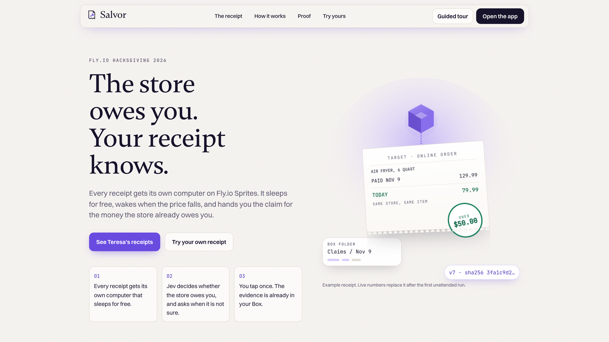
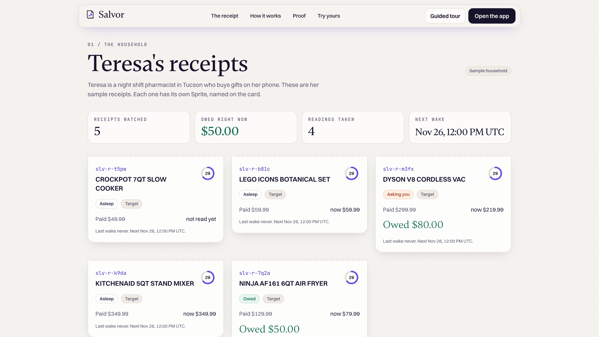
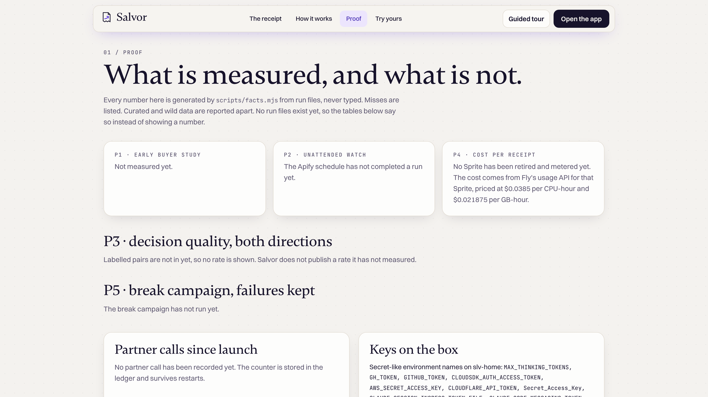
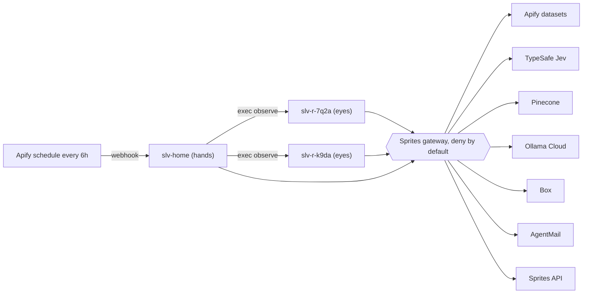

<p align="center"></p>

# Salvor

[](https://github.com/0xkinno/salvor/actions/workflows/ci.yml) [](LICENSE)

**The store owes you. Salvor gives every receipt its own sleeping Sprite that wakes when the price falls and hands you the claim.**

| | |
|---|---|
| Live | the `slv-home` Sprite URL, no login (set at deploy; see `SUBMISSION_HACKSGIVING.md`) |
| For judges | `/judge`, a 60 second walk |
| Try your own receipt | `/try` |
| Proof | `/proof`, numbers from `docs/FACTS.json` |
| Built with | Fly.io Sprites (connectors, name and label policies, network policy, checkpoints, usage API), Apify, TypeSafe Jev, Pinecone, Ollama Cloud, Box, AgentMail |

## Measured

Generated from `docs/FACTS.json` by `scripts/facts.mjs`. Nothing in this block is typed by hand.

<!-- FACTS:START -->
_No run files exist yet, so there are no measured numbers. This block fills from `docs/FACTS.json` the moment they do._
<!-- FACTS:END -->

<p align="center">




</p>

_Screenshots are of the sample household. They are retaken from the live site after the first unattended run._

## Teresa, 7:10am, Black Friday

Teresa Alvarado works nights as a pharmacist in Tucson. Her shift just ended. On November 9 she bought an air fryer
at Target on her phone, on a break. This morning the same air fryer is cheaper. Target's own Holiday Price Match
Guarantee says the store owes her the difference. The store will not tell her. Salvor already has. Her receipt has
its own little computer on Fly.io. It slept for free for eighteen days, woke up when the price was read, and put a
claim in her hand with the evidence already in her Box. She taps once.

Teresa is our example shopper. Her receipts are a sample household, labelled as such everywhere.

### What is true, and where it comes from

| Claim | Source |
|---|---|
| Target matches its own lower price for purchases from Nov 1 if the price falls on or before Dec 24, 2026 | [Target price match page](https://www.target.com/help/article/000062256), saved in `evidence/snapshots/` |
| Matches may be requested at time of purchase or within 14 days after; the item must be identical; a receipt is required | same page |
| Target ended competitor price matching in July 2025 and matches only its own prices | [Good Morning America](https://www.goodmorningamerica.com/living/story/target-end-longtime-price-matching-policy-find-123935014) |
| Black Friday 2026 is Nov 27 | calendar |
| In a UK study of 201 Black Friday deals, 99.5% were the same price or cheaper at other times of the year (context only) | [Which?](https://www.which.co.uk/news/article/99-5-of-black-friday-deals-cheaper-or-the-same-price-at-other-times-of-the-year-ae7Qu2R0yHXW) |

## What Salvor does

1. **Intake.** Forward an order email to the Salvor inbox, or drop a photo or PDF in `Salvor/Receipts` in Box. Ollama reads it into lines. Pinecone maps a cryptic line like `NINJA AF161 6QT` to the right product page.
2. **A computer per receipt.** Each receipt gets its own Sprite, born with its permissions and a network that allows one name. It sleeps for free.
3. **It wakes when something knocks.** An Apify schedule runs every six hours and knocks the home Sprite, which wakes each receipt Sprite. Each reads its own page data, asks Jev whether the store owes money, writes evidence, takes a checkpoint, and sleeps.
4. **You tap once.** Salvor files a claim packet in your Box with a shared link and shows you the amount, the clause and the deadline. You approve. A claim email goes to the owner's test inbox during the hackathon, or you get a three line script to say at the store.

What Teresa does that software cannot: confirm the item when Jev is unsure, approve, and make the ask, because the
store only pays the customer. What always gets through: money owed with the window closing in 48 hours or less.

## What it will not do

| It will not | Where |
|---|---|
| Ask a store for money it cannot back with the store's own clause | `src/policy/engine.ts` |
| Claim on a different variant (the 8 quart case) | `src/policy/gate.ts`, `test/pipeline.test.ts` |
| Let a model produce a number you act on | `src/house/style.ts`, `src/policy/` |
| Estimate a claim for a store whose policy it has not verified | `src/policy/clauses.ts` |
| Trust a reading older than 36 hours | `src/policy/engine.ts` |
| Send anything to a store, or to anyone but the owner's test inbox | `src/connectors/mail.ts` |
| Let a receipt Sprite reach a store site, Box or email | `src/home/fleet.ts`, `SECURITY.md` |
| Learn from its own guesses: only Teresa's confirmations become lasting facts | `src/home/ledger.ts` |

## Explore it in 2 minutes

1. Open `/` and read the hero. 2. Open `/app` and then the receipt with money owed. 3. Press **Verify this claim** and compare both hashes. 4. Open `/fleet`. 5. Paste your own link on `/try`. 6. Failure trigger: answer "a different one" on a question, or try a link to another variant.

Offline proof from a terminal:

```bash
node scripts/verify-claim.mjs https://<your-slv-home-url> <claim id>
```

## How it works



```
Apify schedule -> webhook -> slv-home -> wakes each slv-r-<id> (egress: gateway only)
  slv-r-<id>: read dataset -> Pinecone match -> Jev decide -> evidence file -> checkpoint vN -> report -> sleep
  slv-home:   code computes amount and deadline -> claim packet in Box -> you approve -> email or script
              window closed -> read usage meter -> delete the Sprite
```

**Where the intelligence is, and is not:** models read and decide with calibrated confidence; code computes every
amount and date; Teresa confirms and asks.

## Why a Sprite, specifically

A Sprite has no clock and holds no keys. It sleeps until something knocks, and it reaches the outside only through a gateway that matches its name and labels.

| Primitive | Use in Salvor | Delete test | File |
|---|---|---|---|
| Sleeping computers | One per receipt | One shared process where a poisoned page sits beside your email credential | `src/home/fleet.ts` |
| Access policy | Eyes may read and ask; hands may file and send | A receipt Sprite could send email | `scripts/setup-connectors.mjs` |
| Network policy | One allowed name | A page could make a Sprite fetch anything | `src/home/fleet.ts` |
| Checkpoints | The claim cites a checkpoint and a hash | Evidence lives only in our own database | `src/home/notary.ts` |
| Usage API | Cost per receipt | Cost would be our estimate | `src/home/cost.ts` |

## Partners doing real jobs

| Product | Job | Called from | Delete test |
|---|---|---|---|
| Apify | Reads store pages; its schedule is the clock | `src/connectors/apify.ts` | No readings, nothing wakes |
| TypeSafe Jev | Same item and clause decision with calibrated probabilities | `src/connectors/jev.ts` | No claim is ever prepared |
| Pinecone | Receipt line to listing, embed and rerank | `src/connectors/pinecone.ts` | Lines never find their page |
| Ollama Cloud | Receipt reading, claim words | `src/connectors/ollama.ts` | No intake |
| Box | Receipts in, claim packet out | `src/connectors/box.ts` | No evidence the store can open |
| AgentMail | Receipts inbox, claim email | `src/connectors/mail.ts` | Forwarded orders cannot come in |

Every outside call with its file and line is in [SDK_SURFACE.md](SDK_SURFACE.md). A product that is not called is not claimed.

## Live, substituted, designed

`/api/status` measures each connection with a timestamp. Anything running on a substitute is named on `/proof` with its reason. Wake sources (the Apify schedule and a GitHub Actions backup tick) are designed behaviour and are proven by recorded runs in `evidence/runs/`.

## Friction report

What the platform did that surprised us. Read from `FINDINGS.md`, never from the headline. Filled from the probe on the first real run.

## Recovery

| Event | What happens |
|---|---|
| Duplicate webhook | Idempotent by Apify run id; the repeated wake returns the stored report |
| Receipt Sprite asleep | The exec call wakes it |
| Receipt Sprite deleted | Its usage stays readable in the usage API; the receipt is marked retired |
| A partner is down | The reading becomes "stale" or "ask". Salvor never guesses a claim |
| Jev unavailable | The question goes to Teresa |

## Disclosures

Built with AI coding assistants during Hacksgiving week. Teresa is our example shopper and her receipts are a sample household. No code predates the week. Data sources are public store pages read through Apify and the policy pages cited above. Receipts are kept in the user's Box; receipt Sprites hold typed fields only; the try page restores its Sprite to a blank checkpoint after each visitor.

## Run it

```bash
npm install && (cd web && npm install)
npm test
npm run build
SALVOR_DB=.salvor-local/dev.db node scripts/dev-seed.mjs   # local sample data only
npm start
```

Deploy to Fly (needs your own Sprites token): `node scripts/setup-connectors.mjs`, `node scripts/probe.mjs`, `node scripts/deploy-home.mjs`, `node scripts/setup-apify.mjs`.

## Repository map

`src/policy` clauses, money and the gate. `src/connectors` one file per partner. `src/receipt` the worker that runs inside each receipt Sprite. `src/home` the server, ledger, fleet, notary and claims. `web/` the app. `scripts/` setup, probe, study, facts. `evidence/` snapshots and run files. `PROOF_PLAN.md`, `FINDINGS.md`, `SECURITY.md`, `DESIGN.md`.

MIT licence. Author: 0xkinno.
