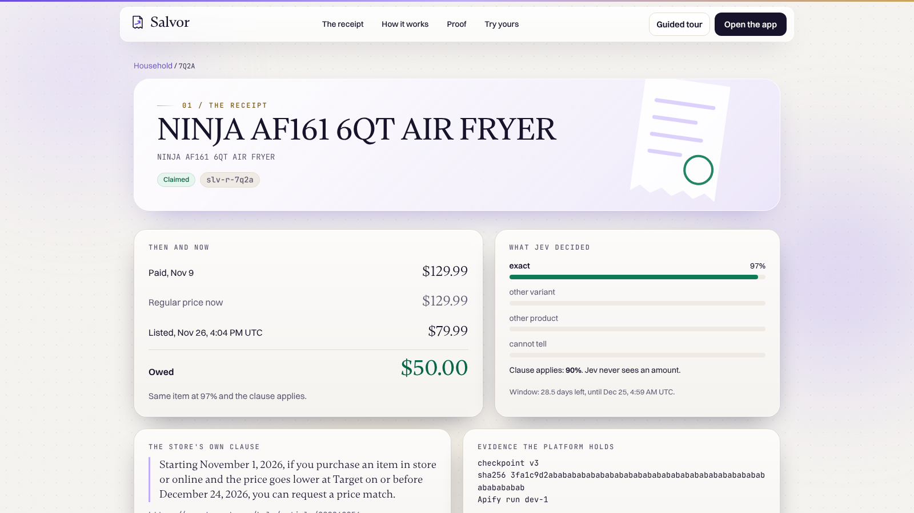
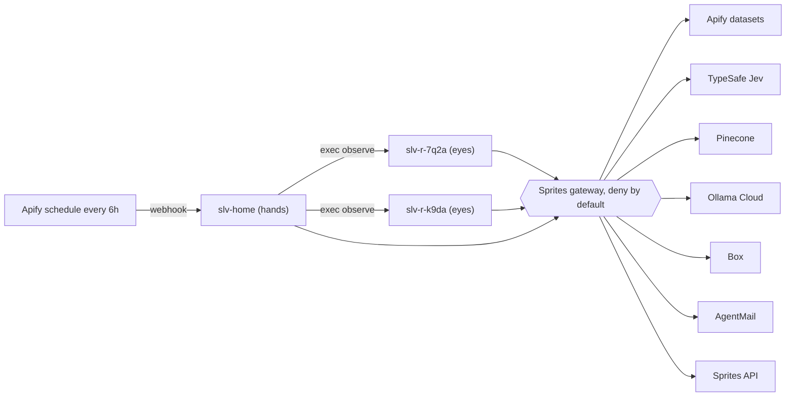

<p align="center"></p>

<h1 align="center">Salvor</h1>

<p align="center"><b>The store owes you. Your receipt knows.</b><br>
Every receipt gets its own sleeping <a href="https://fly.io/sprites">Fly.io Sprite</a>. It wakes when the price falls, decides with <a href="https://typesafe.ai">TypeSafe Jev</a> whether the store owes you, and hands you a claim that is already filed in your Box.</p>

<p align="center">
<a href="https://github.com/0xkinno/salvor/actions/workflows/ci.yml"></a>
<a href="LICENSE"></a>

</p>

| | |
|---|---|
| **Live** | the `slv-home` Sprite URL, no login (printed by `scripts/deploy-home.mjs`, linked in `SUBMISSION_HACKSGIVING.md`) |
| **For judges** | `/judge`: a 60 second, a 3 minute and a 10 minute path |
| **Try your own receipt** | `/try`: paste a Target or Best Buy link, a pooled Sprite reads it live |
| **Proof** | `/proof`: every number comes from `docs/FACTS.json`, misses included |
| **Built with** | Fly.io Sprites, Apify, TypeSafe Jev, Pinecone, Ollama Cloud, Box, AgentMail |
| **Author** | 0xkinno, sole author and contributor |

---

## The idea in one minute

Teresa is a night shift pharmacist. On November 9 she buys an air fryer at Target on her phone. On Black Friday it costs less, and Target's own **Holiday Price Match Guarantee** says the store owes her the difference. The store will not tell her. Re-checking every item she bought, at every store, every day, is the job nobody does.

Salvor does it with one idea: **give every receipt its own computer, and let it sleep.** A Sprite costs nothing asleep, wakes on a knock, keeps its disk, can be checkpointed, and reaches the world only through a gateway whose policy it cannot change. That is exactly the shape this problem has: many small, long waits, each needing a clean separation from the others.

<!-- FACTS:START -->
- **Study (real public data):** 0 usable items of 24 listed; n/a cheaper now; $0.00 owed in total, median n/a; 24 misses listed by id.
- **Unattended watch:** 0 runs, 0 price drops seen.
- **Decision quality at tau n/a:** wrong-claim rate n/a on the curated test split and n/a on wild data; missed-claim rate n/a and n/a.
- **Cost per receipt (Fly usage meter):** n/a per receipt, n/a per receipt per day, 0 metered.
- **Break campaign:** 0 of 0 cases passed; failures are listed on /proof.
<!-- FACTS:END -->

<p align="center">




</p>

_Screenshots show the sample household. They are retaken from the live site after the first unattended run._

---

## Built for the brief, and for each judge

The brief is a personal agent that **runs on a Sprite** and **uses Sprites connectors**. Salvor does both in earnest, and it gives each judge's product a job that disappears if you delete it.

| Judge's product | Its job in Salvor | Delete it and |
|---|---|---|
| **Fly Sprites** | One computer per receipt. Permissions are a label and a network rule. Evidence is a checkpoint. The bill is the platform's own usage meter | there is no product |
| **TypeSafe Jev** | Decides *same item* and *clause applies* with calibrated probabilities. Below the threshold a person decides | no claim is ever prepared |
| **Apify** | The eyes on store pages, and the clock: a schedule that knocks the home Sprite | nothing is read and nothing ever wakes |
| **Pinecone** | Maps a cryptic receipt line (`NINJA AF161 6QT`) to the right listing with embed and rerank | lines never find their page |
| **Ollama Cloud** | Reads receipt photos and forwarded emails into lines; writes the claim in plain words (amounts inserted by code and screened) | no receipt intake |
| **Box** | Teresa's receipts come in from a Box folder; the claim packet goes out to one with a shared link | no evidence the store can open |
| **AgentMail** | A receipts inbox for forwarded orders, and the claim email channel | online orders cannot be forwarded in |

Every outside call, with its file and line, is generated into [SDK_SURFACE.md](SDK_SURFACE.md). A product that is not called is not claimed.

---

## What Salvor does

1. **Intake.** Forward an order email, or drop a photo or PDF in `Salvor/Receipts` in Box. Ollama reads it into lines; Pinecone finds the listing.
2. **A computer per receipt.** Each receipt gets a Sprite, born with its permissions and a network that allows one name. It sleeps for free.
3. **It wakes when something knocks.** An Apify schedule runs every six hours and knocks the home Sprite, which wakes each receipt Sprite. Each reads its page data, asks Jev, writes its evidence, takes a checkpoint and sleeps.
4. **You tap once.** The claim packet (HTML and PDF), the store's clause and the evidence are filed in your Box with a shared link. You approve with a digest-bound, single-use confirmation. A claim email goes to the owner's test inbox during the hackathon, or you get a three line script to say at the store.

**What Teresa does that software cannot:** confirm the item when Jev is unsure ("the 6 quart, not the 8 quart?"), approve, and make the ask, because the store only pays the customer.
**What always gets through:** money owed with the window closing in 48 hours or less. Otherwise at most one question per receipt per day.

### Where the intelligence is, and is not

> Models read and decide with calibrated confidence. Code computes every amount and date. Teresa confirms and asks.

- Ollama reads receipts and writes words. It never produces a number you act on.
- Jev answers *same item?* and *does the clause apply?* with probabilities. It never sees an amount.
- `src/policy/` is pure, tested TypeScript. It computes the window, the deadline and the amount in integer cents, and **raises** on missing data instead of defaulting.
- Untrusted page text is read only inside receipt Sprites. Only typed fields come back.

---

## How it works



```
slv-r-<id> (eyes, egress = the gateway only)
   1 read its page data from the Apify dataset     4 write evidence/<day>.json, take checkpoint vN
   2 Pinecone: is this the receipt's item?         5 report {decision, checkpoint, sha256}
   3 Jev: same item? clause applies?               6 sleep
slv-home (hands): code computes amount and deadline  ->  claim packet in Box  ->  you approve  ->  email or script
                  window closed  ->  read the usage meter  ->  delete the Sprite
```

**Two wake sources, both named and both idempotent by run id:** the Apify schedule webhook, and a GitHub Actions backup tick (`.github/workflows/tick.yml`). A duplicate knock returns the stored report.

---

## Why a Sprite, specifically

A Sprite has no clock and holds no keys. It sleeps until something knocks, and it reaches the outside only through a gateway that matches its name and labels. Each primitive earns its place:

| Primitive | Use | Delete test | Code |
|---|---|---|---|
| Sleeping computers | One per receipt | A poisoned page would share a process with your email credential | `src/home/fleet.ts` |
| Access policy | Eyes read and ask; hands file and send | A receipt Sprite could send email or write to Box | `scripts/setup-connectors.mjs` |
| Network policy | One allowed name | A page could make a Sprite fetch anything | `src/home/fleet.ts` |
| Checkpoints | The claim cites a checkpoint and a hash; `Verify` reads Fly's read-only copy | The evidence would live only in our database, which we could edit | `src/home/notary.ts` |
| Usage API | Cost per receipt from the platform's meter | Cost would be our estimate | `src/home/cost.ts` |
| Exec and filesystem APIs | Home wakes and equips its children | Home could not wake a child | `src/connectors/sprites.ts` |

---

## What it will not do

| It will not | Where |
|---|---|
| Ask a store for money it cannot back with the store's own clause | `src/policy/engine.ts` |
| Claim on a different variant (the 8 quart case) | `src/policy/gate.ts` |
| Let a model produce a number you act on | `src/house/style.ts` |
| Estimate a claim for a store whose policy it has not verified | `src/policy/clauses.ts` |
| Trust a price reading older than 36 hours | `src/policy/engine.ts` |
| Send anything to a store, or to anyone but the owner's test inbox | `src/connectors/mail.ts` |
| Let a receipt Sprite reach a store site, Box or email | `SECURITY.md` |
| Learn from its own guesses: only Teresa's confirmations become lasting facts | `src/home/ledger.ts` |

---

## Verified today

| What | How it was checked |
|---|---|
| The policy engine, the gate, money and time | 39 unit tests, including the Dec 24 boundary, quantity, time zones, and inputs that must raise |
| The whole pipeline: birth, wake, evidence, checkpoint, verify, tamper, retire | 14 tests against a local platform emulator (a test harness, labelled as such, never used by the app) |
| The server: public lock, webhook secret, duplicate runs, path safety | 9 tests |
| The interface | 17 end-to-end checks in Playwright Chromium (hover glow, tour, approve, single-use refusal, error states) and axe WCAG 2.2 AA at five viewports in normal and reduced motion |
| Real store data through Apify | 10 of 10 Target product pages read; see `FINDINGS.md` for the fields that do and do not come back |
| The Target policy | Quoted from the live page and saved with its date in `evidence/snapshots/` |

Honest limits are written down, not hidden: Best Buy's policy page could not be read, so Best Buy claims are held rather than estimated; an archived early-November price is not obtainable, so the study is "watched from Nov 26" (see `PROOF_PLAN.md`, amendment 1).

---

## Live, substituted, designed

`/api/status` measures every connection with a timestamp; nothing is hard-coded as connected. Anything running on a substitute is named on `/proof` with its reason. Wake sources are designed behaviour, proven by recorded runs in `evidence/runs/`.

## Friction report

What the platform and partners did that surprised us, from `FINDINGS.md`:

- Connector path patterns are an exact path or a trailing `*` only, so a connection cannot pin the middle of a path.
- Labels are set by the CLI; the documented REST surface has no label route. Name prefixes give the same separation here.
- The gateway answers 401 to any caller outside a running Sprite, so connector behaviour can only be probed from inside one.
- The store pages read through Apify return price and title but not seller, regular price or availability.

## Recovery

| Event | What happens |
|---|---|
| Duplicate webhook | Idempotent by Apify run id; the repeated wake returns the stored report |
| Receipt Sprite asleep | The exec call wakes it |
| Receipt Sprite deleted | Its usage stays readable in the usage API; the receipt is marked retired |
| A partner is down | The reading becomes "stale" or "ask". Salvor never guesses a claim |
| Jev unavailable | The question goes to Teresa |

---

## Run it

```bash
npm install && (cd web && npm install)
npm test                                  # 71 tests
npm run build                             # worker bundle and web app
node scripts/dev-seed.mjs                 # local sample data only
npm start                                 # http://localhost:8080
node scripts/e2e.mjs                      # interface end to end
node scripts/gates.mjs                    # five viewports, axe, overlap checks
```

Deploy to Fly with your own tokens: `scripts/setup-connectors.mjs`, `scripts/probe.mjs`, `scripts/deploy-home.mjs`, `scripts/setup-apify.mjs`. Verify any claim from a terminal: `node scripts/verify-claim.mjs <url> <claim id>`.

## Repository map

`src/policy` clauses, money, the gate. `src/connectors` one file per partner. `src/receipt` the worker inside each receipt Sprite. `src/home` server, ledger, fleet, notary, claims, intake. `web/` the app. `scripts/` setup, probe, study, facts, gates. `evidence/` snapshots and run files. Documents: [PROOF_PLAN](PROOF_PLAN.md), [FINDINGS](FINDINGS.md), [SECURITY](SECURITY.md), [DESIGN](DESIGN.md), [JUDGE](JUDGE.md), [RISK](RISK.md).

## Disclosures

Built with AI coding assistants during Hacksgiving week, and no code predates the week. Teresa is our example shopper and her receipts are a sample household, labelled as such. Data sources are public store pages read through Apify and the policy pages cited in `MOMENT.md`. Receipts stay in the user's Box; receipt Sprites hold typed fields only; the try page restores its Sprite to a blank checkpoint after each visitor.

MIT licence. Author: **0xkinno**.
