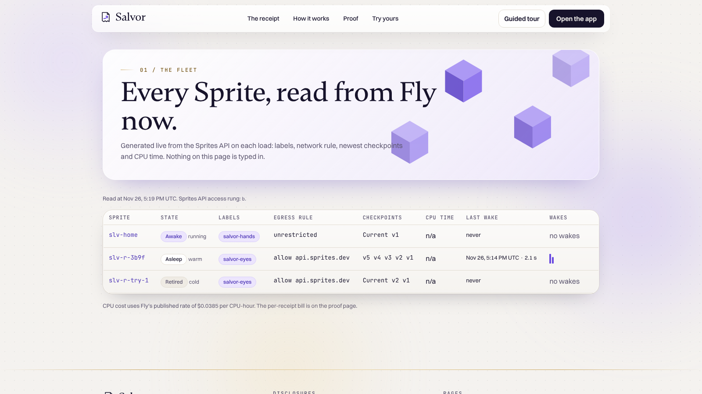
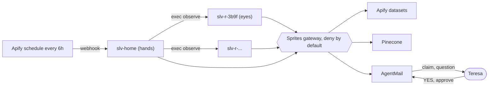

<h1 align="center">Salvor</h1>

<p align="center"><b>The store owes you. Your receipt knows.</b><br>
Every receipt gets its own sleeping <a href="https://fly.io/sprites">Fly.io Sprite</a>. It wakes when the price falls, matches the listing with <a href="https://www.pinecone.io">Pinecone</a>, and writes to you through <a href="https://agentmail.to">AgentMail</a> with a claim and the evidence behind it.</p>

<p align="center">
<a href="https://github.com/0xkinno/salvor/actions/workflows/ci.yml"></a>
<a href="LICENSE"></a>

</p>

<p align="center"></p>

| | |
|---|---|
| **Live** | https://slv-home-b6y6f.sprites.app (no login) |
| **For judges** | `/judge`: a 60 second, a 3 minute and a 10 minute path |
| **Try your own receipt** | `/try`: paste a Target link, a pooled Sprite reads it live |
| **Proof** | `/proof`: every number comes from `docs/FACTS.json`, misses included |
| **Built with** | Fly.io Sprites, Apify, Pinecone, AgentMail |
| **Author** | 0xkinno, sole author and contributor |

---

## What happened this week

These lines are generated from `docs/FACTS.json`, which is generated from run files. A line appears only once it has a measured value.

- **End to end, on the real platform:** an Apify schedule knocked the home Sprite, which woke a receipt Sprite; it read a live Target price, matched the listing with Pinecone, wrote a checkpointed evidence file, and AgentMail delivered the claim to the owner's inbox. A settled receipt's Sprite was then retired with its bill recorded, and the next receipt was born.

<!-- FACTS:START -->
- **Black Friday watch:** 4 runs over 20 hours across 24 items; 0 changed price so far (0 cheaper than at first sight). The schedule keeps running through Monday.
- **Early study (real public data):** 24 items read, 0.0% cheaper than the listed price at the time.
- **Same-item decision at tau 0.9:** 0 wrong claims of 7 on the curated test split (0.0%), 46.2% missed, asked a person on 53.3% of lines.
- **Hard ranking set:** 61 receipt lines, each against 137 real listings; Pinecone rerank first place 91.8% (top three 96.7%), word overlap 90.2% (96.7%). 39 more lines were not ranked because Pinecone's monthly free rerank limit ran out; they are listed by id on /proof.
- **Break campaign:** 9 of 9 cases passed, including a poisoned page and a swapped listing; failures are listed on /proof.
<!-- FACTS:END -->

---

## The idea in one minute

Teresa is a night shift pharmacist. On November 9 she buys an air fryer at Target on her phone. On Black Friday it costs less, and Target's own **Holiday Price Match Guarantee** says the store owes her the difference. The store will not tell her. Re-checking every item she bought, every day, is the job nobody does.

Salvor does it with one idea: **give every receipt its own computer, and let it sleep.** A Sprite costs nothing asleep, wakes on a knock, keeps its disk, can be checkpointed, and reaches the world only through a gateway whose policy it cannot change. That is the shape of this problem: many small, long waits, each needing a clean wall between it and the others.


<p align="center">




</p>

---

## Four products, four real jobs

The brief is a personal agent that **runs on a Sprite** and **uses Sprites connectors**. Salvor does both in earnest. Each product does one job that disappears if you delete it.

| Product | Its job in Salvor | Delete it and |
|---|---|---|
| **Fly Sprites** | One computer per receipt. Permissions are a label and a network rule. Evidence is a checkpoint. The bill is the platform's own usage meter | there is no product |
| **Apify** | The eyes on store pages, and the clock: a schedule that knocks the home Sprite | nothing is read and nothing ever wakes |
| **Pinecone** | The evidence behind every match: embed and rerank find the right listing for a cryptic receipt line (`BELLA 6QT SLIM AIR FRYER`) | receipt lines stop finding their page |
| **AgentMail** | The human loop: forwarded orders come in, questions and claims go out, replies (`YES`) are read as answers | an order cannot come in, and Salvor cannot ask or deliver |

Every outside call, with its file and line, is generated into [SDK_SURFACE.md](SDK_SURFACE.md). Connections are created through Fly's Connectors API with deny-by-default policies (`scripts/setup-connectors.mjs`).

---

## What Salvor does

1. **Intake.** Forward an order confirmation to the Salvor inbox. Rules read the store, the date and each item line. A Sprite is born for the receipt.
2. **A computer per receipt.** Born with the label `salvor-eyes` and a network that resolves one name. It sleeps for free.
3. **It wakes when something knocks.** An Apify schedule runs every six hours and knocks the home Sprite, which wakes each receipt Sprite. Each reads its page data, scores the match with Pinecone, writes its evidence, takes a checkpoint and sleeps.
4. **You reply once.** Salvor emails you the amount, the store's clause and the deadline, or one question ("is this the 6 quart?"). You answer `YES` by email or tap Approve in the app. The approved claim goes to your own inbox with a three line script to say at the store.

**What Teresa does that software cannot:** confirm the item when Salvor is unsure, approve, and make the ask, because the store only pays the customer.
**What always gets through:** money owed with the window closing in 48 hours or less. Otherwise at most one question per receipt per day.

### Where the intelligence is, and is not

> Pinecone ranks. Typed rules decide. Code computes every amount and date. Teresa confirms and asks.

- **The match** (`src/match.ts`) uses Pinecone's rerank score as the evidence about the words, and typed rules for what words cannot tell: size, capacity, pack count and model number. A different capacity is a different variant, always.
- **The money** (`src/policy/`) is pure, tested TypeScript. It computes the window, the deadline and the amount in integer cents, and **raises** on missing data instead of defaulting.
- **The words** of a claim are written by code from the ledger. No model drafts them, so no amount can appear that the ledger does not hold.
- Untrusted page text is read only inside receipt Sprites. Only typed fields come back.

---

## How it works



```
slv-r-<id> (label salvor-eyes, network: the gateway only)
   1 read its page data from the Apify dataset     4 write evidence/<day>.json, take checkpoint vN
   2 Pinecone embed and rerank: is it the item?    5 report {decision, checkpoint, sha256}
   3 typed rules: size, capacity, model number     6 sleep
slv-home (label salvor-hands): code computes amount and deadline -> email the owner -> reply or approve -> send claim
                               window closed -> read the usage meter -> delete the Sprite
```

**Two wake sources, both named and both idempotent by run id:** the Apify schedule webhook, and a GitHub Actions backup tick (`.github/workflows/tick.yml`). A duplicate knock returns the stored report.

---

## Why a Sprite, specifically

A Sprite has no clock and holds no keys of its own. It sleeps until something knocks, and it reaches the outside only through a gateway that matches its name and labels. Each primitive earns its place, and each was checked on the real platform:

| Primitive | Use | Checked on Fly | Code |
|---|---|---|---|
| Sleeping computers | One per receipt | create 191 ms, first exec 361 ms, warm exec 135 ms; Node 24 on the Sprite | `src/home/fleet.ts` |
| Labels and connector policy | A labelled Sprite sees only the eyes connections; an unlabelled one sees none | verified from inside both | `scripts/setup-connectors.mjs` |
| Network policy | One allowed name | `target.com` fails to resolve, the gateway answers, `network.json` is read-only | `src/home/fleet.ts` |
| Checkpoints | The claim cites a checkpoint and a hash; `Verify` reads Fly's own copy | edit the live file after the checkpoint: the platform copy still matches, the live file is flagged | `src/home/notary.ts` |
| Usage API | Cost per receipt from the platform's meter | read before deletion | `src/home/cost.ts` |

---

## What it will not do

| It will not | Where |
|---|---|
| Ask a store for money it cannot back with the store's own clause | `src/policy/engine.ts` |
| Claim on a different variant (the 8 quart case) | `src/match.ts`, `src/policy/gate.ts` |
| Auto-claim when the receipt line has nothing specific to match on | `src/match.ts` |
| Let any text carry an amount the ledger does not hold | `src/house/style.ts` |
| Estimate a claim for a store whose policy it has not verified | `src/policy/clauses.ts` |
| Trust a price reading older than 36 hours | `src/policy/engine.ts` |
| Send anything to a store, or to anyone but the owner's inbox | `src/connectors/mail.ts` |
| Let a receipt Sprite reach a store site or send email | `SECURITY.md`, break tests below |
| Learn from its own guesses: only Teresa's answers become lasting facts | `src/home/ledger.ts` |

---

## Proven on the real platform

| What | Result |
|---|---|
| Real run, end to end | Apify webhook, wake, real Target price, evidence file, checkpoint, claim of $12.00, email delivered through AgentMail |
| Tamper detection | Edited the live evidence file after its checkpoint. Verification still matched Fly's copy and flagged the live file |
| Break tests (P5) | All pass, run on the live Sprite: a poisoned page text and a swapped 8 quart listing cannot produce a claim; an eyes Sprite cannot reach the mail or Sprites API connections, cannot resolve `target.com` or `bestbuy.com`, cannot rewrite its own network policy; edited evidence is caught; text with a foreign amount is rejected |
| Match decision, curated pairs | 108 pairs built from real Target listings; threshold chosen on a tune split only; see the measured block above |
| Pinecone's contribution | Finds the right listing for a cryptic line: first place for 24 of 24 lines among 24 real candidates against 22 of 24 for word overlap, and on the 100 line hard set a small edge over word overlap (see the measured block above, with the lines it could not rank listed by id) |
| Code | 81 tests; 17 end-to-end interface checks in Playwright; axe WCAG 2.2 AA at five viewports in normal and reduced motion |

Limits, stated plainly: Pinecone's free plan allows 500 rerank requests a month, which ran out during the hard ranking run, so part of that set is unranked and the live match falls back to the typed rules (stricter, so more lines go to a person); the curated set is easy, so rules alone match Pinecone there; the ranking study is where Pinecone shows its value. The study is "watched from Nov 26": early-November prices could not be read from archives. Best Buy's policy page could not be verified, so Best Buy items are held, never estimated.

## Friction report

What the platform surprised us with (from `FINDINGS.md`):

- A connector may not point at the Sprites API ("blocked: base URL targets the Sprites API itself"), so `slv-home` holds one Sprites token in a 0600 file and `/proof` shows it.
- Fly's checkpoint mount stayed empty after a checkpoint, so verification restores the checkpoint, reads the file, and restores the live state (4 to 11 seconds).
- The usage API returns 404 for a deleted Sprite, so Salvor reads the meter before deleting.
- Connector path patterns are an exact path or a trailing `*` only.
- Fly allows one dedicated connector per provider; eyes and hands each use a named custom connector for Pinecone.
- The no-card trial allows 3 Sprites in total: home, one receipt and one try-it Sprite. Settled receipts are retired to free a slot.
- The dedicated Apify connector allows only run details and dataset reads, so starting a run uses a named custom connector pinned to one path.
- A gateway request that waits about a minute is cut, and a page read takes 35 to 60 seconds, so Salvor starts the Apify run, polls it with short requests and then reads its dataset.
- The gateway closes idle connections; a repeated read after a reset is safe, a repeated write is not, so only reads are retried.

## Recovery

| Event | What happens |
|---|---|
| Duplicate webhook | Idempotent by Apify run id; the repeated wake returns the stored report |
| Receipt Sprite asleep | The exec call wakes it |
| Receipt Sprite deleted | The receipt is marked retired; its meter was read first |
| Partner outage | The reading becomes "stale" or "ask". Salvor never guesses a claim |
| Weak match | The question goes to Teresa by email |

---

## Run it

```bash
npm install && (cd web && npm install)
npm test                                  # 80 tests
npm run build                             # worker bundle and web app
node scripts/dev-seed.mjs                 # local sample data only
npm start                                 # http://localhost:8080
node scripts/e2e.mjs                      # interface end to end
node scripts/gates.mjs                    # five viewports, axe, overlap checks
```

Deploy to Fly with your own tokens: `scripts/setup-connectors.mjs`, `scripts/probe.mjs`, `scripts/deploy-home.mjs`, `scripts/setup-apify.mjs`. Verify any claim from a terminal: `node scripts/verify-claim.mjs <url> <claim id>`.

## Repository map

`src/policy` clauses, money, the gate. `src/match.ts` the match decision. `src/connectors` Apify, Pinecone, AgentMail and the Sprites API. `src/receipt` the worker inside each receipt Sprite. `src/home` server, ledger, fleet, notary, claims, intake and delivery. `web/` the app. `scripts/` setup, probe, studies, facts, gates. `evidence/` snapshots and run files. Documents: [PROOF_PLAN](PROOF_PLAN.md), [FINDINGS](FINDINGS.md), [SECURITY](SECURITY.md), [DESIGN](DESIGN.md), [JUDGE](JUDGE.md), [RISK](RISK.md).

## Disclosures

Built with AI coding assistants during Hacksgiving week, and no code predates the week. Teresa is our example shopper and her receipts are a sample household, labelled as such. Data sources are public store pages read through Apify and the policy pages cited in `MOMENT.md`. Receipt Sprites hold typed fields only; the try page restores its Sprite to a blank checkpoint after each visitor.

MIT licence. Author: **0xkinno**.
